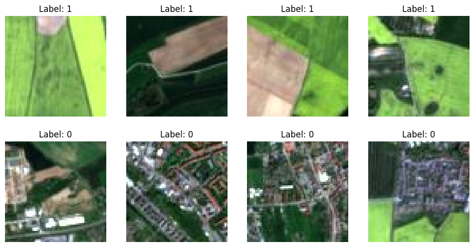
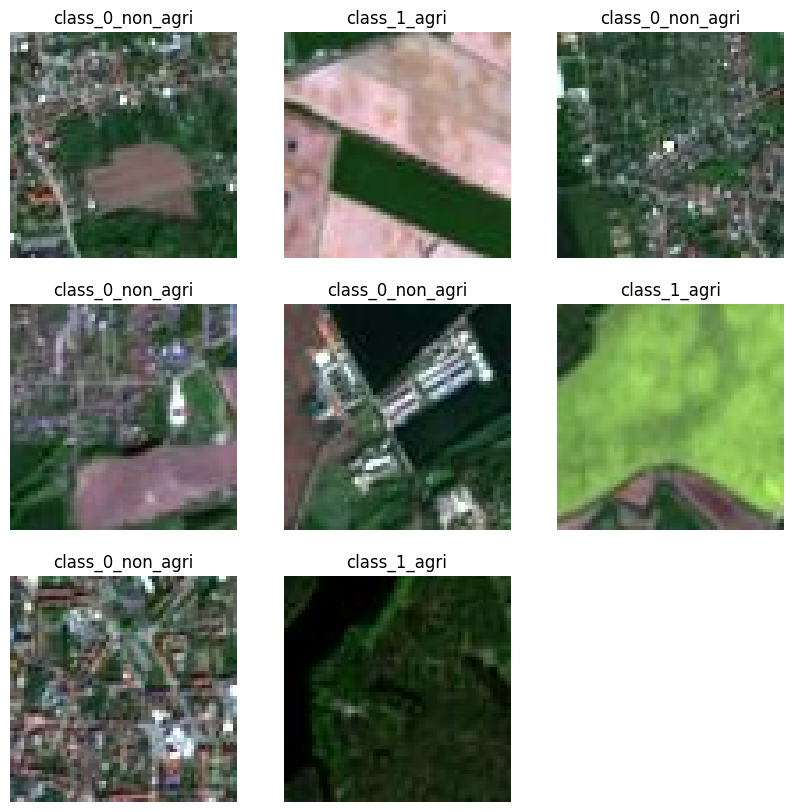

# Data Loading and Augmentation Using Keras

Building efficient image data pipelines in Keras: a **custom Python data generator** compared with the **built-in `tf.keras.utils.image_dataset_from_directory` utility**, including augmentation and `tf.data` performance tuning (`.map()`, `.cache()`, `.prefetch()`).


---

## Table of Contents

1. [Overview](#overview)
2. [Dataset](#dataset)
3. [What the Notebook Does](#what-the-notebook-does)
4. [Results](#results)
5. [Custom Generator vs Keras Utility](#custom-generator-vs-keras-utility)
6. [Key Takeaways](#key-takeaways)
7. [Repository Structure](#repository-structure)
8. [Getting Started](#getting-started)
9. [Limitations and Future Work](#limitations-and-future-work)
10. [Tech Stack](#tech-stack)
11. [Acknowledgements](#acknowledgements)
12. [License](#license)

---

## Overview

Training an image model on a large dataset means you cannot simply load every image into RAM. This project builds the same input pipeline in two ways and compares them:

1. **Custom data generator**: a Python generator (`yield`) that loads, resizes, normalizes and returns batches on the fly. It shows how data loading works under the hood.
2. **Keras built-in utility**: `image_dataset_from_directory`, which returns an optimized `tf.data.Dataset` with automatic label inference, shuffling, batching and a validation split.

The task used for both is binary classification of satellite images: **agricultural land vs non-agricultural land**.

## Dataset

Satellite image tiles, downloaded automatically in the notebook (about 20 MB):

```
https://cf-courses-data.s3.us.cloud-object-storage.appdomain.cloud/4Z1fwRR295-1O3PMQBH6Dg/images-dataSAT.tar
```

| Property | Value |
|---|---|
| Classes | 2 (`class_0_non_agri` = 0, `class_1_agri` = 1) |
| Images | 6,000 in total (3,000 per class) |
| Image size | 64 x 64 pixels, RGB |
| Training / validation split | 4,800 / 1,200 (80% / 20%) |

```
images_dataSAT/
├── class_0_non_agri/    # non-agricultural land (label 0)
└── class_1_agri/        # agricultural land (label 1)
```

## What the Notebook Does

| Step | Task | What was done |
|---|---|---|
| 1 | Setup | Installed and imported TensorFlow, NumPy and Matplotlib, then downloaded and extracted the dataset |
| 2 | **Task 1** | Built `all_image_paths` and `all_labels` from both class folders (label 0 for non-agri, 1 for agri) |
| 3 | **Task 2** | Bound paths and labels with `zip`, shuffled them together, and printed 5 random pairs |
| 4 | Custom generator | Defined `custom_data_generator`: per-epoch shuffling, batch slicing, image loading with `load_img` / `img_to_array`, normalization to the 0-1 range |
| 5 | **Task 3** | Pulled one batch of 8 with `next()`, printed its shapes and displayed the images with their labels |
| 6 | Keras utility | Created `train_ds` with `image_dataset_from_directory` (64 x 64, batch size 8, `validation_split=0.2`) |
| 7 | **Task 4** | Created `val_ds` using `subset='validation'` |
| 8 | Performance tuning | Added augmentation (`RandomFlip`, `RandomRotation`) with `.map()`, then `.cache()` and `.prefetch(AUTOTUNE)` |

## Results

| Check | Result |
|---|---|
| Custom generator image batch shape | `(8, 64, 64, 3)` |
| Custom generator label batch shape | `(8,)` |
| Files found by Keras | 6,000 belonging to 2 classes |
| Training / validation files | 4,800 / 1,200 |
| Class names inferred by Keras | `['class_0_non_agri', 'class_1_agri']` |

**One batch from the custom generator** (label 1 = agricultural, label 0 = non-agricultural):



**One batch from the Keras utility** (class names inferred from folder names):



## Custom Generator vs Keras Utility

This is the qualitative comparison from the lab, not a measured benchmark.

| Feature | Custom data generator | `image_dataset_from_directory` |
|---|---|---|
| Ease of use | Low: loops, shuffling and batching are written by hand | High: one function call |
| Code complexity | High: you manage paths, labels, loading and preprocessing | Low: handled for you |
| Flexibility | Very high: any custom loading logic | Moderate: expects a `class/images` folder layout |
| Features | Basic: shuffling, augmentation and validation split must be coded | Built-in shuffling, batching, validation split and Keras preprocessing layers |
| Performance | Poor to moderate: single-threaded Python loop | Excellent: `tf.data` with `.cache()` and `.prefetch()` |
| Best for | Learning, or non-standard data sources | Most standard image classification tasks |

## Key Takeaways

- A **generator** with `yield` loads one batch at a time, so memory use stays small no matter how large the dataset is.
- Writing the generator by hand teaches how shuffling, batching and normalization work, but it needs a lot of code.
- `image_dataset_from_directory` gives labels, shuffling, batching and a validation split in a single call, and it produces a `tf.data.Dataset` that TensorFlow can optimize.
- `.map()` applies augmentation in parallel, `.cache()` avoids re-reading files each epoch (when the data fits in RAM), and `.prefetch()` prepares the next batch while the model trains.

## Repository Structure

```
keras-data-loading-augmentation/
├── notebooks/
│   └── Data_Loading_and_Augmentation_Keras.ipynb   # Full notebook with outputs
├── images/
│   ├── custom_generator_batch.png
│   └── keras_utility_batch.png
├── .gitignore
├── LICENSE
├── README.md
└── requirements.txt
```

## Getting Started

### Prerequisites

- Python 3.9 to 3.12
- An internet connection (the dataset downloads when the notebook runs)

### Installation

```bash
# 1. Clone the repository
git clone https://github.com/<your-username>/keras-data-loading-augmentation.git
cd keras-data-loading-augmentation

# 2. (Recommended) create a virtual environment
python -m venv .venv
source .venv/bin/activate        # Windows: .venv\Scripts\activate

# 3. Install dependencies
pip install -r requirements.txt
```

### Run the notebook

```bash
jupyter notebook notebooks/Data_Loading_and_Augmentation_Keras.ipynb
```

Use **Kernel > Restart & Run All**. The dataset is extracted to `images_dataSAT/` (ignored by git).

> The notebook has three download cells (`skillsnetwork.prepare`, Keras `get_file` and `!tar -xf`). Outside Skills Network Labs, the Keras `get_file` cell is the one that works on its own. If it fails, download the archive from the URL above and extract it into the folder you run the notebook from.

## Limitations and Future Work

- The comparison is qualitative. Timing both pipelines on the same data (and measuring memory) would turn it into evidence.
- The custom generator loops forever (`while True`), so training with it needs `steps_per_epoch`, and the last batch of each pass can be smaller than the rest.
- In the Keras pipeline, `.cache()` is applied after the augmentation `.map()`, so the augmented images from the first pass are cached and reused. For fresh random augmentation each epoch, apply `.cache()` before the augmentation step.
- The notebook builds the loaders but does not train a model. A natural next step is to train a small CNN with each loader and compare accuracy and epoch time.
- Add image normalization (for example a `Rescaling` layer) to the Keras pipeline, since the custom generator divides by 255 but the Keras utility keeps pixel values in the 0-255 range.

## Tech Stack

- **Python**
- **TensorFlow / Keras** (`tf.data`, `image_dataset_from_directory`, preprocessing layers)
- **NumPy**: array handling
- **Matplotlib**: visualization
- **skillsnetwork**: dataset download helper
- **Jupyter Notebook**

## Acknowledgements

- Completed as part of the IBM AI Engineering course (IBM Skills Network). The lab structure, instructions and dataset are from that course and are © IBM Corporation.
- My work in the notebook: the path and label lists, shuffling, testing and visualizing the custom generator, and creating the validation dataset.

## License

My code is released under the [MIT License](LICENSE). The lab instructions and dataset remain © IBM Corporation.
